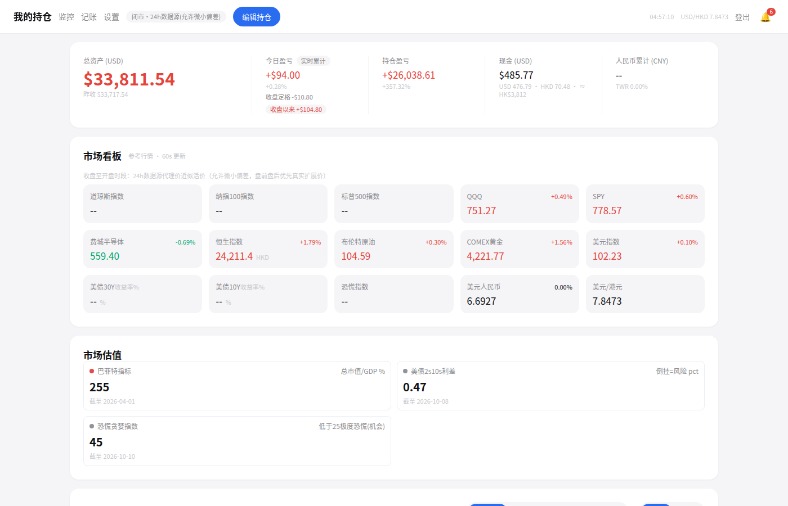
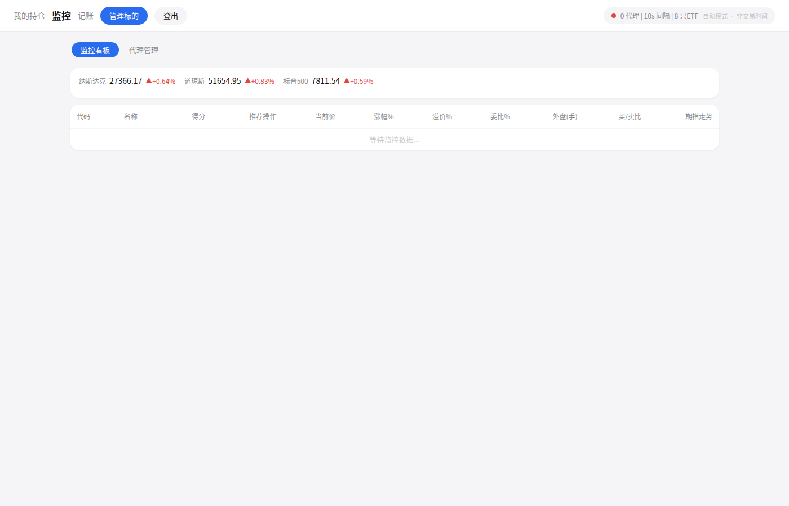
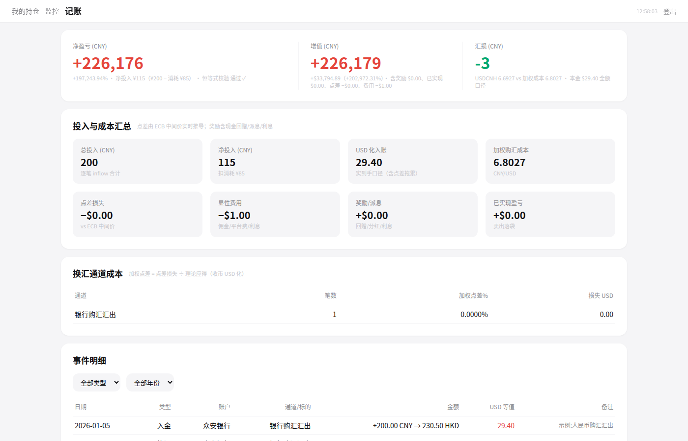

# Watchfolio —— 券商风格个人持仓网站

券商风格的个人持仓管理网站：**美股 + 港股 + 场外基金 + 现金（统一 USD 口径）**，附带一条 **A 股 QDII ETF 竞价监控**（4 步决策模型）与**记账报表**子系统。

前后端一体：FastAPI + MySQL 后端，无构建的单文件前端；一切曲线/回显从数据库重建，前端不直接消费外部行情。







## 项目简介

### 核心特性

- **一场口径三层恒等式**：`今日盈亏（实时累计） = 收盘定格盈亏 + 夜盘增量`——任何时段（盘前/盘中/盘后/夜盘/周末）盈亏可拆解、可对账；冷启动自动锚点恢复，恢复失败带退化标记、开盘自愈。
- **24h 活价**：收盘→开盘全段（盘后/夜盘/盘前/周末）由「24h数据源」提供活价，真实盘前盘后扩展价优先；夜盘价含同标的替代推导（如 QQQM→QQQ 涨跌幅映射）。
- **邮件自动记账成交应用**：定时拉取券商成交邮件，幂等入库 `trade_records` 后自动应用持仓与现金（双源门控防营销邮件误入；任一源失败水位不推进、按水位回溯）。
- **单位净值 TWR**：以记账现金流事件对组合市值日线做份额重放，入金不虚增收益；前端「市值 | 净值」双模式走势。
- **看板 spark 全库内重建**：分时全由主价快照「价变即写」累积落库，悬浮显示北京时间+价格；杂点日自动回退上一完整时段。
- **宏观四指标**：巴菲特指标、席勒 CAPE、美债 2s10s 利差、恐慌贪婪指数，每日日更落库。
- **期指主源 + 降级链**：腾讯 fu 前缀恒主源（搭行情总线零额外请求），东财 futsseapi → 新浪 hf_ 两级冷备（健康状态机 60s 冷却）。
- **A 股 ETF 竞价监控（4 步决策模型）**：期指修正 → 宏观情景分类 → 盘口否决 → 评分排序，输出「买入/放弃」建议与推荐买入价（不自动下单）。
- **记账报表**：换汇通道点差对比、盈亏恒等式（`净盈亏 = 总资产×汇率 − 总投入 = 增值 + 汇损 − 消耗`）、ECB 每日参考价缓存。

### 设计原则

**少请求、多数据**——能批量不逐只（多源共用一条攒批总线）、能缓存不重查（exchangeInfo 24h / 库内累积 / 锚点节流）、回显与折线全部从数据库重建，请求失败用上一份落库数据兜底，不放大对外请求。

## 模块架构

| 模块 | 职责 |
|------|------|
| `server.py` | FastAPI 入口 + 全部后台轮询循环（持仓/行情/监控/候选/邮件/活价探测/记账汇率/宏观） |
| `config.py` | `qdii.env` 加载（幂等 setdefault）与全局配置 |
| `database.py` | MySQL 表结构与全部 CRUD（含种子持仓/看板/现金） |
| `portfolio_fetcher.py` | 持仓侧数据源抓取与解析（腾讯/新浪/Yahoo/FT/twelvedata/长桥/24h数据源） |
| `fetcher.py` | A 股 ETF 监控抓取（腾讯 ETF + 期指智能路由） |
| `tencent_bus.py` | 腾讯行情攒批发送路由（监控/候选/持仓/看板共用同一节奏，微批合并） |
| `email_trader.py` | 券商成交邮件解析 → 幂等入库 → 自动应用持仓与现金 |
| `ledger.py` | 记账报表纯计算（点差/通道/盈亏恒等式）+ 单位净值 TWR（现金流重放） |
| `macro_fetcher.py` | 宏观四指标日更抓取与解析 |
| `longport_fetcher.py` | 长桥 OpenAPI 封装（限流信号量/凭证热加载/token 续期） |
| `ledger_seed.example.py` | 记账种子事件格式示例（真实流水不入库） |
| `init_db.py` | 一次性初始化：建表 + 种子数据 + 初始账号（users 为空时创建，口令随机或环境变量注入） |
| `static/portfolio.html` | 单文件前端（持仓主页/监控页/记账页/登录页） |

### 邮件版式扩展

邮件自动记账当前内置三类券商成交邮件版式：汇丰（「全部執行」汇总门控）、众安、致富（「待成交 = 0」终态门控，同发件人营销邮件由解析门槛拦截）。新增一家券商只需两步：

1. 在 `email_trader.py` 实现该版式的解析函数——正则提取成交字段（代码/方向/数量/价格/币种等）并映射到 `trade_records` 表口径；
2. 在邮件分发逻辑中按发件人/主题特征注册路由，并补一组该版式的离线样例测试。

欢迎以新增版式的方式贡献扩展，覆盖更多券商即扩展数据源覆盖面。解析门槛（如「全部執行」标记、终态校验）是防营销邮件误入账的关键，移植时务必保留等价门控。

## 数据源与配置总览

| 数据源 | 用途 | 需要 key | 获取渠道 | 频次（正常态） |
|--------|------|----------|----------|----------------|
| 腾讯行情 | A股 ETF/美股/港股现价、全球指数、期指主价、看板混排 | 免 key | — | 总线 10s 节流；指数 60s |
| 新浪 | 期指深冷备/外汇/盘前盘后扩展价 | 免 key | — | 随轮（降级触发） |
| 东财 | 期指冷备 | 可选 token（`QDII_EASTMONEY_TOKEN`） | 接口公开，token 不强校验 | 仅降级触发 |
| Yahoo | 基金 NAV 兜底、美债/恐慌指数主价、USDHKD | 免 key（常态走代理池） | — | backfill 节奏（4h 冷却/5min 重试）+ 低频 spark |
| FT | 基金 NAV 主源 | 免 key | — | 60s |
| twelvedata | 美股兜底 + 离岸美元人民币主价 + 锚点恢复兜底 | 需免费 key | twelvedata 官网免费注册（8 credits/min） | 60s 节流 |
| 长桥 | 冷启动锚点恢复主源（日K）、扩展价、看板指数主价 | 需 OpenAPI 凭证 | 长桥 OpenAPI 控制台 | 严格限流（官方 1s≤10 次，调用侧信号量摊薄） |
| 24h数据源 | 收盘→开盘全段美股活价 | 自建可选增强 | 自建 | 闭市 60s；未配置自动降级新浪扩展价定格口径 |
| 股票行情网关 | 无交易标的（AMKR/PCG/F 等）夜盘活价补齐 | 自建可选增强 | 自建 | 闭市 60s 逐只；未配置自动跳过 |
| ECB | 记账汇率日线（USD/CNY、USD/HKD 参考价） | 免 key | 公开数据 | 每日 22:35 |
| FRED | 宏观日更：巴菲特指标 + 2s10s 利差 | 免 key | 公开 CSV API | 每日 22:40 |
| multpl | 宏观日更：席勒 CAPE | 免 key | 公开数据页 | 每日 22:40 |
| CNN | 宏观日更：恐慌贪婪指数 | 免 key | 公开页面（失败回退 VIX 分位） | 每日 22:40 |
| 邮件 IMAP | 券商成交邮件自动记账 | 需授权码 | 邮箱设置开启 IMAP 生成授权码 | 30min 双源同轮 |

> 说明：24h数据源与股票行情网关为**自建可选增强**，无配置时自动降级（对应标的回退新浪扩展价定格口径），不影响其余功能。所有 key 经 `qdii.env` 注入，见 [`qdii.env.example`](qdii.env.example)。

## 自建行情网关（可选）

**背景**：加密数据源对部分服务器 IP 有访问限制，直连不可达时可部署一个 Cloudflare Worker 反向代理作中转——「股票行情网关」即由此而来。无交易标的（AMKR/PCG/F 等）的夜盘活价补齐同样经该网关：业务侧 `X-Auth-Token` 与 `X-H24-APIKEY` 双头同值鉴权，消费逻辑见 `portfolio_fetcher.py`。

部署步骤：

1. 生成访问令牌：`openssl rand -hex 16`；
2. 按下方示例部署 Worker，把令牌配置为 Worker 侧校验值；
3. 将 Worker 地址填入 `qdii.env` 的 `QDII_EQUITY_QUOTE_URL`，令牌填入 `QDII_EQUITY_API_KEY`，重启服务生效。

```js
const TOKEN = "XXX";  // 例: openssl rand -hex 16 生成

const ROUTES = [
  ["/spot/", "https://api.binance.com"],   // 现货 /api/v3 (bStocks)
  ["/sapi/", "https://api.binance.com"],   // 美股行情 /sapi/v1/equity/...
  ["/fapi/", "https://fapi.binance.com"],  // TradFi 永续 /fapi/v1/...
];


export default {
  async fetch(request) {
    if (request.headers.get("x-auth-token") !== TOKEN) {
      return new Response("forbidden", { status: 403 });
    }
    const url = new URL(request.url);
    for (const [prefix, origin] of ROUTES) {
      if (url.pathname.startsWith(prefix)) {
        const headers = new Headers(request.headers);
        headers.delete("x-auth-token");
        headers.delete("host");
        headers.delete("cookie");
        return fetch(origin + url.pathname + url.search, {
          method: request.method,
          headers,
          body: ["GET", "HEAD"].includes(request.method) ? undefined : request.body,
        });
      }
    }
    return new Response("no route", { status: 404 });
  }
};
```


> 不部署也不影响主功能：未配置时相关标的自动降级（扩展价定格口径 / 直接跳过），其余数据源与功能不受影响。

## 快速开始（Docker Compose，推荐）

一条命令拉起三个服务：`db`（MySQL 8，utf8mb4，数据卷持久化 + healthcheck）→ `init`（一次性建表 + 种子数据 + 初始账号，成功后退出）→ `app`（FastAPI 主服务，8888 端口）。

```bash
# 1. 克隆
git clone <repo-url> && cd qdii

# 2. 配置
cp qdii.env.example qdii.env
vi qdii.env   # 取消注释并填好数据库 5 键（QDII_DB_*），Docker 路径下固定为：
              #   QDII_DB_HOST=db      ← 写 compose 的 db 服务名，不是 127.0.0.1
              #   QDII_DB_PORT=3306    ← 容器内端口，不是 3914
              #   QDII_DB_USER=qdii
              #   QDII_DB_PASS=<自拟口令>
              #   QDII_DB_NAME=qdii
              # 其余数据源键按需配置，不配自动走各自降级链，不影响启动

# 3. 一条命令启动（db 健康后 init 建表种子，app 等 init 成功退出才起）
docker compose --env-file qdii.env up -d

# 4. 查看初始化输出（建表 + 种子 + 初始账号提示）
docker compose logs init

# 5. 浏览器访问 http://<your-domain>:8888
```

> 说明：
> - 带 `--env-file qdii.env` 时，db 服务的账号密码经变量替换**自动与 qdii.env 保持一致**，无需两处手改；直接 `docker compose up -d` 不带 `--env-file` 会落到 compose 默认档凭证，需自行保证与 qdii.env 一致，否则连库被拒。
> - `init` 服务成功后显示 `Exited (0)` 属正常，不是故障。
> - 生产可自行绑定域名并反代到 8888 端口。

常用运维：

```bash
docker compose ps                  # 三服务状态（init 为 Exited(0) 属正常）
docker compose logs -f app         # 跟主服务日志
docker compose down                # 停止（db 数据卷保留）
docker compose down -v             # 停止并删卷（清库重来）
docker compose build && docker compose --env-file qdii.env up -d   # 改代码后重建
```

### 初始账号与口令

`init_db.py` 仅在 `users` 表**为空**时创建初始账号 `admin`（口令以 pbkdf2 哈希落库，见 `database.py` 的 `hash_password`）：

- 口令优先取环境变量 `QDII_ADMIN_PASSWORD`（`qdii.env` 中的同名键同样生效）；
- 未设置时随机生成（`secrets.token_urlsafe(12)`），并打印醒目日志行：

```
[init] 初始账号 admin / 初始口令 <值> —— 请立即登录并修改
```

日志走 stdout——systemd 部署下 `journalctl -u <服务名>`、docker 部署下 `docker logs` 均可见。`users` 表已有账号时跳过创建，重复运行不会覆盖既有口令。**首次启动后请立即修改口令。**

修改口令（前端与设置页均无改密入口——设置页仅管理系统配置项 `sys_config`，不含 `users` 表）：

```bash
python3 -c "from database import hash_password; print(hash_password('你的新口令'))"
# 再执行 SQL：
# UPDATE users SET password='<上面输出的哈希>' WHERE username='admin';
```

## 手动部署（venv，非 Docker）

```bash
# 1. 克隆
git clone <repo-url> && cd qdii

# 2. 环境（Python 3.12+）
python3 -m venv venv && source venv/bin/activate
pip install -r requirements.txt

# 3. 配置
cp qdii.env.example qdii.env
vi qdii.env   # 至少填好数据库 5 键（QDII_DB_*），其余按需

# 4. MySQL 建库（utf8mb4）
mysql -h<host> -P<port> -u<user> -p -e \
  "CREATE DATABASE IF NOT EXISTS qdii DEFAULT CHARACTER SET utf8mb4"

# 5. 初始化（建表 + 种子数据 + 初始账号；口令见「初始账号与口令」）
python3 init_db.py

# 6. 启动（服务端口 8888）
uvicorn server:app --host 0.0.0.0 --port 8888
```

浏览器访问 `http://<your-domain>:8888`。

## 默认标的清单修改

| 内容 | 位置 | 修改方法 |
|------|------|----------|
| 美股/港基持仓种子 | `database.py:409-417`（`seed_holdings`） | 初始化前直接改该列表；已初始化的库建议登录后在前端增删改（持仓 API 已覆盖），改种子对已存在行不生效（INSERT IGNORE 幂等） |
| A股监控 ETF 种子 | `init_db.py:13-22`（`SEED_ETFS`） | 初始化前改列表（代码/名称/关联期指指数）；已初始化的库通过监控页/接口增删 |
| 候选池种子 | `init_db.py:25-36`（`SEED_CANDIDATES`） | 同上 |

种子均为「不存在才写入」，**对已初始化的库修改种子不会更新已有行**，改后重启服务生效（新增条目在下一轮初始化脚本运行时补插）。

## 测试

```bash
python3 -m pytest tests/test_portfolio.py tests/test_decision_model.py \
  tests/test_server_auth.py tests/test_email_trader.py tests/test_longport.py \
  tests/test_alert_engine.py tests/test_alert_api.py tests/test_daily_bars.py \
  tests/test_longport_push.py tests/test_macro_fetcher.py tests/test_ledger.py \
  tests/test_nav.py
```

- 测试为纯本地运行（不起服务）；
- `tests/test_ledger.py` 依赖本地 `ledger_seed.py`（真实记账流水，**隐私不入库**、已被 gitignore）：文件缺失时 `pytest.importorskip` 自动跳过实算测试（见 `tests/test_ledger.py:15-18`）；格式参考 `ledger_seed.example.py`，复制为 `ledger_seed.py` 即可跑全量。
- 其余 `tests/` 下文件为存量/探索性脚本，不在基线内。

## 已知局限与未实现

### 未实现

| 条目 | 说明 |
|------|------|
| 入金邮件自动入账 | CNY 原币入账通道无通知邮件版式，入金事件维持人工/API 录入（换汇/转出/派息三类版式已识别） |
| 众安通知邮件自动轮询 | 换汇/转出/派息/入金四类通知仅供记账对账采样，按需拉取、不自动入账 |
| 记账前端手动录入表单 | 有意裁剪：API 为唯一录入通道（`POST /api/ledger/events`，ref_no 幂等） |
| 期指 DAX 数据源 | 三级降级链均无可用代码，系存量状态 |
| CNY 口径 TWR 净值 | 现仅 USD 口径时间加权净值，汇率因子叠加未排期 |
| DCF 合理价因子 | 有意砍掉：合理价需人工假设参数，仅保留可客观计算的因子 |

### 半自动

| 条目 | 说明 |
|------|------|
| A股 ETF 竞价决策模型 | 仅输出「买入/放弃」建议与推荐买入价，不自动下单，需人工确认 |
| 结单记账录入 | 月结单经本地 skill 半自动处理（解析→入库→对账），仍需人工核对差异 |
| 美股夜盘活价 | 24h数据源/股票行情网关为自建可选增强，无配置时自动降级（慢轮 + 新浪扩展价定格口径） |
| 前端验收 | UI 变更无自动化浏览器测试，依赖上线后人工验收 |

### 受限

| 条目 | 说明 |
|------|------|
| 免费代理池境内中转 | 仅个别节点有境外出口；24h数据源靠镜像直连，失效时境外代理自动接管 |
| Yahoo 常态 403 | 主价/分时依赖代理池 backfill（4h 冷却/5min 重试节奏），直连基本不可用 |
| 新浪直连恒 403 | 已改代理优先两段式（代理全败回退直连保底），正常态零告警 |
| 美元指数双通道 | 无腾讯替代代码，唯一供给 = Yahoo 主价 + 新浪经代理冷备，双挂时断供 |
| twelvedata 免费额度 | 8 credits/min，仅作兜底与离岸汇率主价，60s 节流 |
| 长桥接口限流 | 官方 1s≤10 次、并发≤5，调用侧全局信号量 + 顺序逐只摊薄 |
| 全球指数单通道 | N225/KS11 唯一稳定通道为腾讯 gz 前缀，其余通道对云服务器 IP 风控 |

## 记账与入金

### 入金为何要手动录入

换汇/转出/派息三类事件有银行通知邮件可采样辅助；**入金（CNY 原币入账）无通知邮件版式**，需手动录入。银行账户之间的后续流转（活期 → 证券户等）无需关心——页面展示的是总资产口径，月结单可借记账 skill 定期兜底入账核对。

### 口述录入示例

> 「我从交通银行汇款 1 万人民币到众安，并且在众安转换成了 1491.48 美元，汇率 6.704742，帮我记一下账」

录为两笔事件（演示值，格式可直接照抄）：

1. `inflow`：币种 CNY、金额 10000（`cny_amount=10000`），`ref_no` 自定幂等键（如 `in-20261010-cmb-za`）；
2. `fx`：CNY 10000 → USD 1491.48，`mid_rate` 取 ECB 当日参考价（实际成交汇率与参考价的偏差即点差）。

效果：总投入累计增加、持仓现金增加，换汇点差自动进入通道成本报表。

### 录入通道

- **skill（推荐）**：项目内 `.claude/skills/ledger-ingest/SKILL.md`（Claude Code 项目级自动识别，也可复制到 `~/.claude/skills/` 全局使用）——对话口述流水即可完成录入并自动对账；
- **API 直录**：`POST /api/ledger/events`，body 为 `{"events": [...]}`，`ref_no` 幂等（重复提交自动去重），字段口径见 skill 文件与 `ledger_seed.example.py`。

## 目录结构

```
qdii/
├── server.py              # FastAPI 入口 + 后台轮询循环
├── config.py              # env 加载与全局配置
├── database.py            # MySQL 表结构 + CRUD + 种子持仓
├── portfolio_fetcher.py   # 持仓侧数据源抓取
├── fetcher.py             # A股 ETF 监控抓取
├── tencent_bus.py         # 腾讯行情攒批总线
├── email_trader.py        # 成交邮件自动记账
├── ledger.py              # 记账报表 + TWR 纯计算
├── macro_fetcher.py       # 宏观四指标日更
├── longport_fetcher.py    # 长桥 OpenAPI 封装
├── init_db.py             # 一次性初始化（建表/种子/初始账号，口令随机或 env 注入）
├── Dockerfile             # 镜像构建（python:3.12-slim + uvicorn 8888）
├── docker-compose.yml     # db + init + app 三服务编排
├── .dockerignore          # 构建上下文最小化（密钥/隐私/无关目录不入镜像）
├── vix_seed.py            # VIX 日K种子导入（可选，一次导入历史底座）
├── StockWatcher/          # 配套 Windows 任务栏看盘小工具（独立子项目）
├── ledger_seed.example.py # 记账种子事件格式示例
│                          #   （复制为 ledger_seed.py 填真实流水；
│                          #    已 gitignore，供 tests/test_ledger.py 使用）
├── static/portfolio.html  # 单文件前端
├── tests/                 # pytest 测试
├── docs/                  # 系统全景/数据源架构等设计文档
├── scripts/check_secrets.py  # 提交前密钥门禁
├── qdii.env.example       # 环境变量模板（全注释）
├── AGENTS.md              # AI 协作开发规范（模块口径/数据源矩阵/部署细节）
└── AGENTS.local.md        # 本地环境信息（不入库，自行创建）
```

## AI 协作

仓库内置 `AGENTS.md` 协作规范（模块口径/数据源矩阵/部署细节）与 `.claude/skills/ledger-ingest` 记账录入 skill：用 Claude Code 打开本项目，即可获得记账录入、对账与开发协作辅助。

## 免责声明

本项目为个人自用项目：仅供学习交流，页面数据来自公开行情接口，数据版权归原数据商所有，请勿用于商业用途；不构成任何投资建议；无自动下单、无荐股功能，决策模型输出仅作参考提示。
